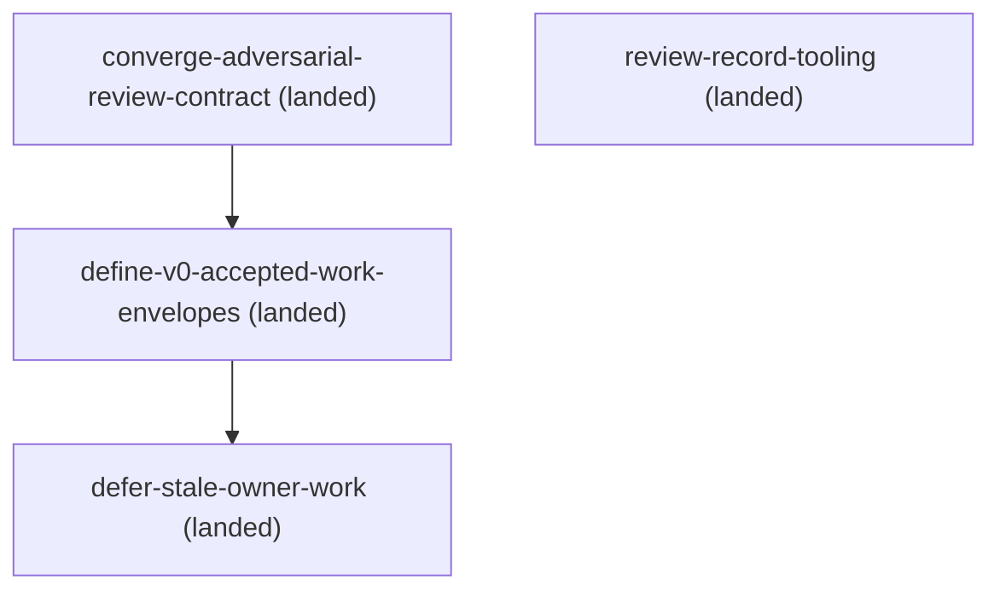

# Roadmap

The living orchestration contract is `SKILL.md` plus its phase and role references. Active changes below are ordered by their front-matter dependencies; the generated diagram is authoritative only as a projection of those declarations.

## Active changes

- `docs/changes/archive/2026-07-31-converge-adversarial-review-contract/` (landed) — establish risk-triggered pre-implementation review and stable requirement and finding identities.
- `docs/changes/archive/2026-08-13-define-v0-accepted-work-envelopes/` (landed) — define the four versioned, strategy-neutral accepted-work envelopes and their offline owner validation seam.
- `docs/changes/archive/2026-08-16-defer-stale-owner-work/` (landed) — move two pre-coordination proposals into trigger-gated deferred work, correct landed status wording, and remove obsolete local recovery state.
- `docs/spec/deferred-work.md` (deferred register) — preserve validation-evidence and review-bound accept-and-execute options until their explicit promotion triggers fire.
- `docs/changes/archive/2026-10-21-review-record-tooling/` (landed) — offline stdlib tooling for the review-record envelope (matrix/ledger/envelope identity per review-record-contract v0.1.0): `matrix-hash`, `ledger-hash`, `init`, `freeze`, `append`, `verify` plus a 61-case test suite; editorial contract-doc section; no contract semantics change.

<!-- BEGIN GENERATED DAG (regenerate: doc-contract update --repo-root .) -->

<!-- END GENERATED DAG -->
