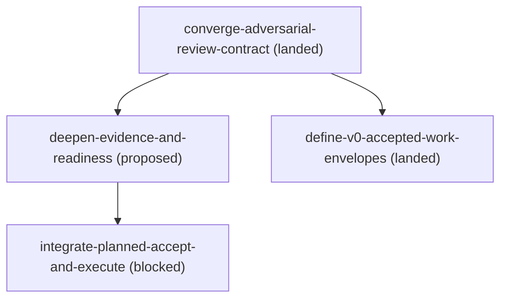

# Roadmap

The living orchestration contract is `SKILL.md` plus its phase and role references. Active changes below are ordered by their front-matter dependencies; the generated diagram is authoritative only as a projection of those declarations.

## Active changes

- `docs/changes/archive/2026-07-31-converge-adversarial-review-contract/` (landed) — establish risk-triggered pre-implementation review and stable requirement and finding identities.
- `docs/changes/archive/2026-08-13-define-v0-accepted-work-envelopes/` (landed) — define the four versioned, strategy-neutral accepted-work envelopes and their offline owner validation seam.
- `docs/changes/deepen-evidence-and-readiness/` (proposed) — deepen readiness and validation evidence after the review-record contract is stable.
- `docs/changes/integrate-planned-accept-and-execute/` (blocked) — transfer an owned provisional draft into the item worktree, bind review-bound acceptance to an immutable artifact snapshot, and land lineage plus implementation in one final commit after the local evidence interface and external provider capability land.

<!-- BEGIN GENERATED DAG (regenerate: doc-contract update --repo-root .) -->

<!-- END GENERATED DAG -->
